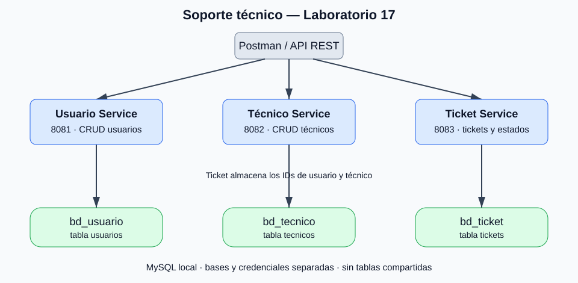
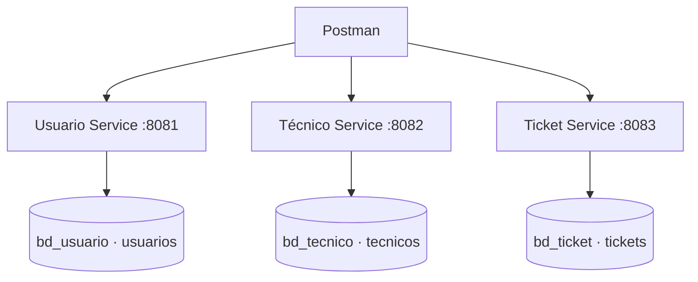

# Diagrama de microservicios

- Cada servicio es dueño de sus tablas y tiene su propia cuenta de MySQL.
- Las tres bases pueden vivir en la misma instancia local de MySQL: no comparten tablas.
- Ticket almacena `idUsuario` e `idTecnico` como números. No usa `@ManyToOne` entre servicios.
- Ticket no consulta las bases ni las API de Usuario/Técnico: los IDs se toman de las respuestas de Postman.
- No existe un componente de descubrimiento, gateway ni contenedores.
